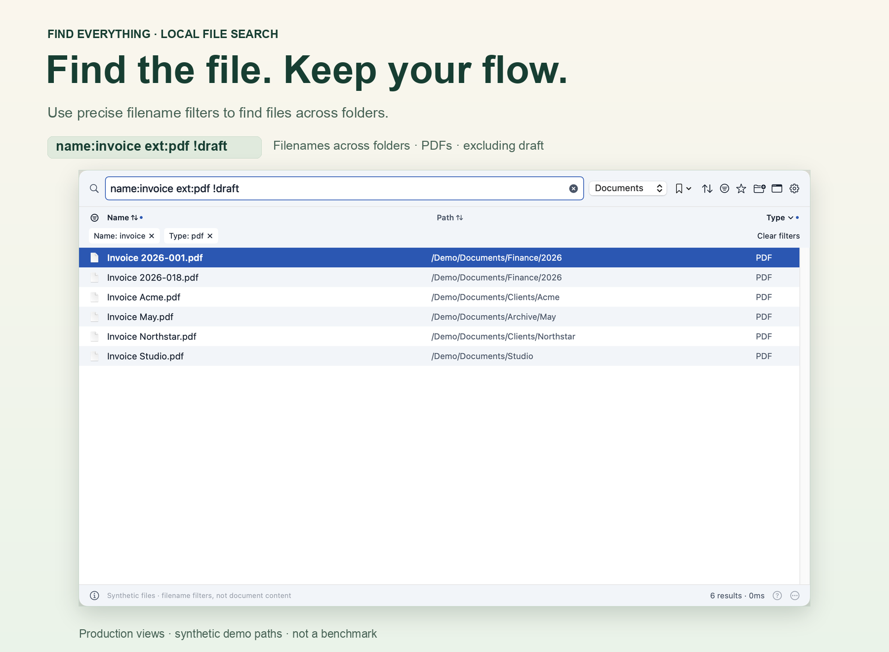
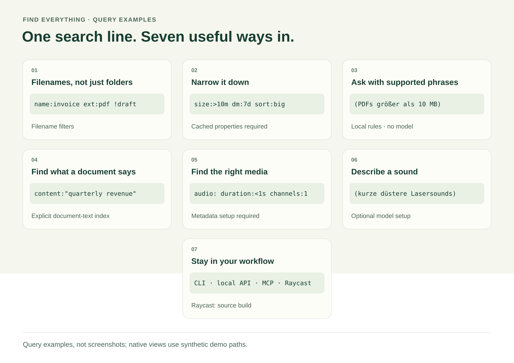
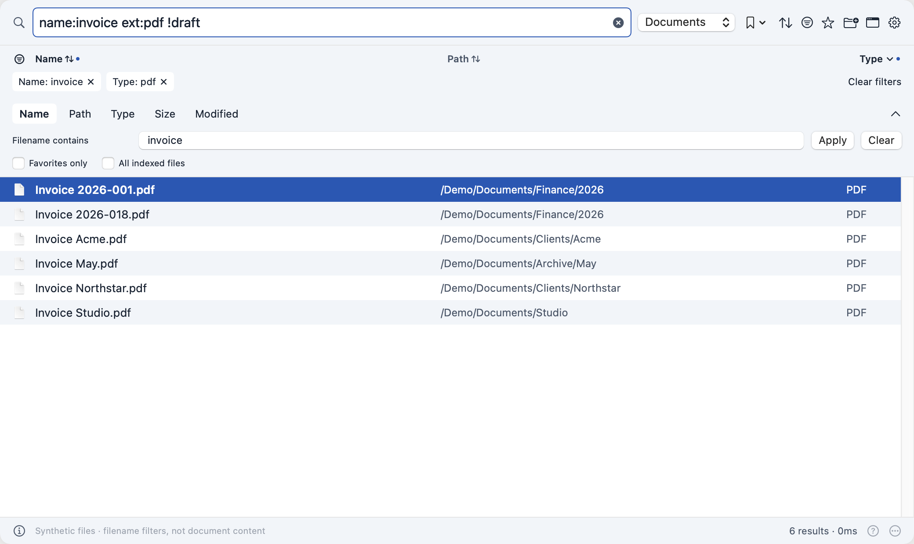
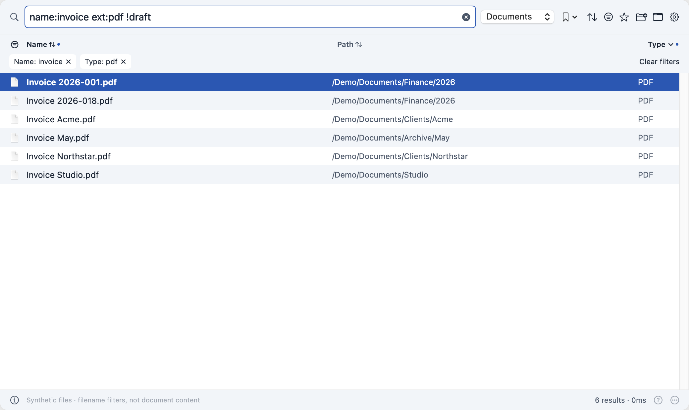
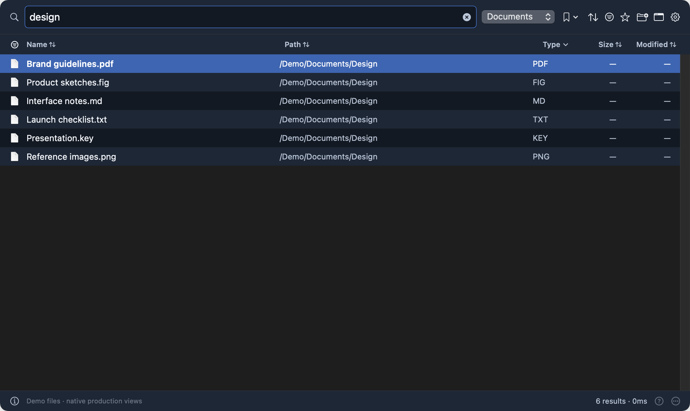
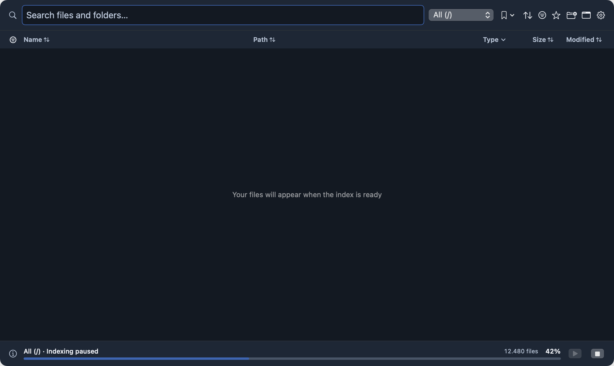

<p align="center">
  
</p>

*The query matches the **filenames**, not a shared folder called “Invoice”. Production views, synthetic demo files; not a performance benchmark.*

# Find Everything

**Find the file. Keep your flow.**

Local-first file search for macOS. Find a filename across folders, combine precise filters, preview the result and get back to work. Native SwiftUI/AppKit app · JSON CLI · local API · MCP · optional Raycast extension.

**New in 0.3.9:** live indexing and metadata work run in an owned worker, keeping the API responsive during update batches. Search readers apply pending changes before reading; caches retain snapshot binding and current warnings. The measured replay eliminated three status timeouts in 36 probes, with extra memory and first-search synchronization costs. [Measurements and limits](docs/BENCHMARKS-2026-11-13.md#live-processing-and-api-responsiveness). Existing indexes and display preferences stay usable. First-time broad searches and exact counts can still be slow. Rebuild with `--exhaustive` to include hidden, ignored and generated files, `Library` and `.local`.

[**Get the 0.3.9 preview**](https://github.com/Supersynergy/find-everything/releases/tag/v0.3.9) · [Features](#features) · [Search examples](#one-line-many-ways-to-find-it) · [Meaning search](docs/INSTANTFIND.md) · [Build from source](#build-from-source) · [CLI](#cli-quick-start) · [Privacy](#local-data-and-privacy) · [Release notes](docs/release/RELEASE-NOTES.md)

> **Apple Silicon preview — not notarized.** The downloadable build is locally signed, not signed with a trusted Developer ID or Apple-notarized. Gatekeeper may refuse it. We do not recommend disabling Gatekeeper, removing quarantine or changing privacy permissions to bypass this. Build from source with your own signing identity, or wait for a notarized release. Intel and older macOS versions have not been verified.


## Features

### Find the file, not just a matching folder

Search indexed filenames and paths, or use `name:` to match only the filename. Combine extensions, folder restrictions, exclusions and alternatives in the same line. Search Documents, Downloads, Applications, a chosen project, multiple roots or a combined saved index.

### Narrow thousands of possibilities to the right few

Filter by file group, extension, size, modification date or favourites. Click column headings to sort, or expand the separate filter and sort bars. Size/date filters and sorting use **cached properties**; unknown values are reported, not guessed.

### Write a supported phrase instead of memorising every filter

`(PDFs größer als 10 MB)` and `(Dateien aus den letzten 7 Tagen)` become local file filters. Supported English/German phrases use rules, **not a chat model**. Search details expose the translation; this is not arbitrary natural-language understanding.

### Find a document by what it says

Prepare document text once, then combine `content:"quarterly revenue"` with filename, folder, extension, size/date and sort filters. In the native app, open **Settings → Indexes → Index document contents**; CLI users run `fe content index --index work`.

Text/code files use UTF-8; extractable PDFs use the bundled local PDFKit helper, and macOS Office/RTF uses `textutil`. The unbundled CLI fallback requires both `pdftotext` and `pdfinfo`; PDFs are skipped if their page count cannot be verified. Searches read the cache, not source document bodies, and never scan folders for this feature. Preparation is bounded and resumable. Unsupported, changed, unreadable or oversized files remain unknown—not proof of no match. Search replies keep `complete:false`: cached text cannot prove that no current document matches.

**Limits:** no OCR or semantic document search. Text is capped at 2 MiB; PDF/Office inputs at 32 MiB and extracted text at 2 MiB; PDFs at 1,000 pages. Hidden paths are skipped. Cached document text is private but **not encrypted**. Re-run preparation after edits; `fe content clear --index work` clears cached text without deleting originals.

### Find the right sound—or describe it

Search prepared media by duration, channel count, sample rate, bitrate or image/video dimensions. `audio: duration:<1s` finds short audio by metadata, regardless of its filename. Optional local sound search ranks prepared audio by descriptions such as `(kurze düstere Lasersounds)`.

**Setup matters:** media properties need explicit extraction. Sound descriptions additionally require checkout-based runtime/model setup and audio analysis. Models and their runtime dependencies are **not bundled** in the preview archive; acoustic results are approximate.

### Do something with the result

Quick Look with `Space`, open with `Return`, reveal in Finder, choose **Open With**, set preferred apps per extension, copy paths or open the enclosing folder in Terminal. Multi-select for batch actions; keep the app as a popup or a normal resizable window.

### Keep your workflow—and your index—local

Save searches with their folder/project scope, pin favourites, revisit search history and optionally learn from successful opens. Use the same query language through the CLI, permission-restricted local service, MCP or the separate Raycast extension. No hosted product account is needed for normal search.



### More than a search box

<details>
<summary><strong>📋 Show 8 entries</strong></summary>

- **Saved searches + favourites**<br>
  What it does: Keep a query and its scope; combine `favorites:true` with other filters.

- **Optional local learning**<br>
  What it does: Successful opens can improve relevance. Opt out or reset it; explicit sorts retain priority.

- **Quiet live updates**<br>
  What it does: The macOS file journal updates changed paths. Journal gaps are reported, not hidden behind an automatic full rescan.

- **Continuous result lists**<br>
  What it does: Scroll the indexed match set through a virtual native table with bounded caches—not a separate view for every file.

- **Visible index preparation**<br>
  What it does: First launch schedules All once; later rebuilds are explicit. Pause/resume or cancel in the footer. Scanning shows a count, not an invented percentage.

- **Reusable indexes**<br>
  What it does: Combine existing indexes without another filesystem traversal.

- **Your preferred view**<br>
  What it does: Light/dark/system appearance, text size, density, columns, visibility filters and preview options.

- **Useful automation**<br>
  What it does: JSON output, exact indexed-match counts, stable pages and coverage warnings for scripts and agents.

</details>


[**Full capability guide, prerequisites and source references →**](docs/FEATURES.md)

## One line, many ways to find it

<details>
<summary><strong>📋 Show 8 entries</strong></summary>

- **A phrase inside a document**<br>
  Try…: `content:"quarterly revenue" ext:pdf`<br>
  Preparation: Source checkout + explicit document-text index

- **Invoice PDFs, without drafts**<br>
  Try…: `name:invoice ext:pdf !draft`<br>
  Preparation: Saved path index

- **PDFs or Markdown in Downloads**<br>
  Try…: `ext:pdf;md in:downloads`<br>
  Preparation: An index containing Downloads

- **Large files changed this week**<br>
  Try…: `size:>10m dm:7d sort:big`<br>
  Preparation: Cached size/date properties

- **Your favourite PDFs**<br>
  Try…: `favorites:true ext:pdf`<br>
  Preparation: Pin files first

- **A supported German file phrase**<br>
  Try…: `(PDFs größer als 10 MB)`<br>
  Preparation: Cached size properties

- **Mono sounds under a second**<br>
  Try…: `audio: duration:<1s channels:1`<br>
  Preparation: Extract audio metadata

- **Sounds by description**<br>
  Try…: `(kurze düstere Lasersounds)`<br>
  Preparation: Optional sound model + analysed audio

</details>


**Document contents require explicit preparation.** A normal filename/path query does not search document text; use `content:` for that. No OCR is provided. Semantic search means optional **audio** similarity, not semantic document search. Coverage remains limited by chosen roots, supported formats, exclusions, permissions and preparation.

## See the filters, not just the theme



The filename filter excludes a fixture whose **folder** contains “Invoice” but whose filename does not. A regression test runs this example through the production search backend. Images render the production SwiftUI/AppKit views offscreen with synthetic `/Demo/Documents` paths; they are not captures of personal files or proof of interactive/accessibility verification.

<details>
<summary>Light and dark appearances</summary>





</details>

<details>
<summary>A missing index is not “no files found”</summary>


A missing selected scope exposes indexing actions. Separately, the first app launch schedules All once using its configured roots and exclusions. Pause, resume or cancel from the visible footer. Canceling a scan keeps the prior valid index; canceling lookup preparation keeps the newly completed path snapshot so preparation can resume.

- ****<br>
  Preparing the lookup: measured progress: 




These are rendered production views with fixture progress, not scans of personal files or speed measurements.

</details>

## Get the preview

The complete app archive requires **macOS 15 or later on Apple Silicon**; its native helper binaries target macOS 15. It was built and checked on macOS 15.8.2. The source app/CLI target alone is not the compatibility floor of the complete bundle.

The [release page](https://github.com/Supersynergy/find-everything/releases/tag/v0.3.9) contains:

- `FindEverything.app.zip`: Apple Silicon app with its bundled CLI and native helpers.
- `SHA256SUMS.txt`: archive and manifest checksums.
- `release.json`: version, architecture, signature limitations and archive digest.

Download the files to the same directory and check them before opening anything:

```sh
shasum -a 256 -c SHA256SUMS.txt
```

Checksums detect changed downloads; they do **not** substitute for trusted publisher signing or notarization. The remote `install.sh` requires its pinned publisher **and** Gatekeeper approval. It deliberately refuses an unapproved preview and preserves an existing installation. It does not select this prerelease as the latest stable download.

### Build from source

Prerequisites: macOS, Xcode Command Line Tools/Swift, Bun and the optional search tools you intend to use. The preview was built on Apple Silicon with Bun 1.4.4; other environments need their own verification. Install prerequisites using a package manager you trust. The app no longer downloads and executes missing tool archives itself.

```sh
git clone https://github.com/Supersynergy/find-everything.git
cd find-everything
bun install --frozen-lockfile
# Optional external search helpers:
brew install fd ripgrep fzf
bun run check
bash scripts/check-keyboard.sh
bash app/bundle-app.sh
# Choose an existing certificate fingerprint from security find-identity:
FE_SIGN_IDENTITY="YOUR_40_CHARACTER_CERTIFICATE_FINGERPRINT" \
  bash scripts/sign-app.sh 'app/Find Everything.app'
```

This creates `app/Find Everything.app`. Signing never falls back to ad-hoc, and it will not silently rotate an installed identity. See [the signing script](scripts/sign-app.sh).

For a local update from a checkout, `bash install.sh --local` makes an app rollback backup and uses the chosen signing identity. It also installs the CLI link, shell completion and the app's login agent. It does **not** opt you into a live indexing daemon or replace existing watcher/maintenance scopes. No installer is run merely by cloning or reading this page.

## CLI quick start

Create one named index for a folder you deliberately choose:

```sh
bun run src/cli.ts index --path "$HOME/Documents" --name work
bun run src/cli.ts search 'name:invoice ext:pdf !draft' --index work --json
# Cache size/date properties before filtering by them; repeat while pending > 0:
bun run src/cli.ts properties --index work --max-files 10000 --seconds 30
bun run src/cli.ts search 'ext:pdf size:>10m' --index work --json
bun run src/cli.ts indexes --json
# Explicitly cache document text; repeat while pending > 0:
bun run src/cli.ts content index --index work --max-files 500 --seconds 30 --json
bun run src/cli.ts search 'content:"quarterly revenue" ext:pdf' --index work --json
bun run src/cli.ts content status --index work --json
# Optional: remove cached text, not original documents:
bun run src/cli.ts content clear --index work --json
```

Once installed, replace `bun run src/cli.ts` with `fe`. Use `fe --help` for the command list. `fe mcp` provides the local MCP interface; the native app normally uses a permission-restricted Unix socket rather than an exposed remote service.

### Include files excluded by a normal scan

```sh
# Explicitly rebuild the chosen index, including hidden/ignored/generated folders:
fe index --index work --exhaustive
fe prepare --index work
fe search 'receipt view:all' --index work --json
# Restore the standard exclusions on a later explicit rebuild:
fe index --index work --no-exhaustive
```

In the app, use **Settings → Indexes → Rebuild with all accessible files**, then **Settings → Search → Show all indexed files**. Adding a folder includes these files unless you choose project source only. Existing snapshots gain those paths after an explicit rebuild; changing the view alone cannot add missing paths.

`--exhaustive` preserves your explicit `--exclude` patterns and never bypasses macOS permissions. An All index includes mounted volumes but skips virtual `/dev`, `/proc`, `/sys` and the duplicate macOS `/System/Volumes/Data` tree. Directory symlinks are not followed. Scan failures and skipped newline-containing paths prevent `complete:true`. Completeness describes matches in the saved snapshot, not proof that every current disk file is accessible. An inclusive scan can need more time and space; the existing limits remain.

Search keys use canonical Unicode normalization while returned paths retain their exact spelling. Existing search databases remain readable; `fe prepare` upgrades their derived lookup from saved paths without another directory scan. [Reproducible Hyperfine benchmark](docs/BENCHMARKS-2026-11-12.md).

### Large indexes

The flat path index is streamed to disk with backpressure. The current path index replaces the former 1-GiB output cutoff with a finite **32-GiB maximum**, limited further by the free disk space available at the start, leaving a 2-GiB reserve in that initial budget. Timeouts, path-length checks and atomic replacement remain in place. This does not promise an index of every protected macOS file; permissions, excludes, scan time and available disk still apply.

A failed or canceled scan must not publish a partial path index over the previous snapshot. First app launch schedules All once; later full rebuilds remain explicit. Canceling derived lookup preparation retains the completed path snapshot and resumable preparation. The release process itself does not scan your Mac.

## Local data and privacy

Source review found no hosted product accounts, advertising or product analytics in this scope. This is not a complete runtime-network audit. The application stores file paths, metadata, saved scopes, favourites, preferences and optional ranking history locally:

<details>
<summary><strong>📋 Show 4 entries</strong></summary>

- **`~/.cache/hypersearch`**<br>
  Contents: Derived indexes, search databases, optional unencrypted document-text caches, socket metadata and logs

- **`~/.config/find-everything`**<br>
  Contents: Index profiles and local signing-identity pin

- **`~/Library/Application Support/FindEverything`**<br>
  Contents: Favourites, ranking/warm-view data, helpers and app rollback backups

- **macOS user defaults for `com.supersynergy.findeverything`**<br>
  Contents: Display, scope and interaction preferences

</details>


Index deletion and removing a saved profile are not deletion of the original files. The normal startup/search path does not require a cloud account. User-requested external actions may open a browser; optional model setup downloads from Hugging Face/npm and needs its own licence review. GitHub hosts source and releases. Installers/package managers contact their own upstreams when you deliberately run them.

For uninstall/cleanup, first quit the app and stop only the Find Everything agents you installed. Back up favourites, preferences and rollback copies you want to keep. Remove the app/CLI/login-agent entries and only then the specific local data directories above if you want a complete reset. Removing those directories discards saved preferences and derived indexes and is not part of a normal update. Never paste unredacted file lists, local paths or socket tokens into a public issue.

## Verification and limitations

Release checks cover project tests/typechecking, native model/navigation/table/presentation tests, bundle signature and version consistency, archive checksums, included notices and product-image presence. Independent report-only passes covered data preservation, security boundaries, licences/privacy, resource bounds and UI source states. These are scoped checks, not a security or legal certification.

Manual screen/keyboard/VoiceOver acceptance has not been completed for this preview. Synthetic offscreen rendering does not replace it. Long-running memory/recovery behaviour, Intel, older macOS, the bundled runtime's complete advisory coverage and a complete third-party legal review remain unverified. The JavaScript dependency audit was checked for 0.3.1. See [the register](COMPLIANCE.md).

## Contributing

Keep changes focused and run `bun run check`; native changes also need `bash scripts/check-keyboard.sh`. Include a regression test and explain any new network access, stored data or background work. Do not commit credentials, index contents, personal screenshots or local acceptance receipts.

[Report a reproducible bug](https://github.com/Supersynergy/find-everything/issues) with the version, macOS version and a privacy-clean example. Source is [MIT](LICENSE); bundled components retain their [own terms](THIRD-PARTY-NOTICES.md).
