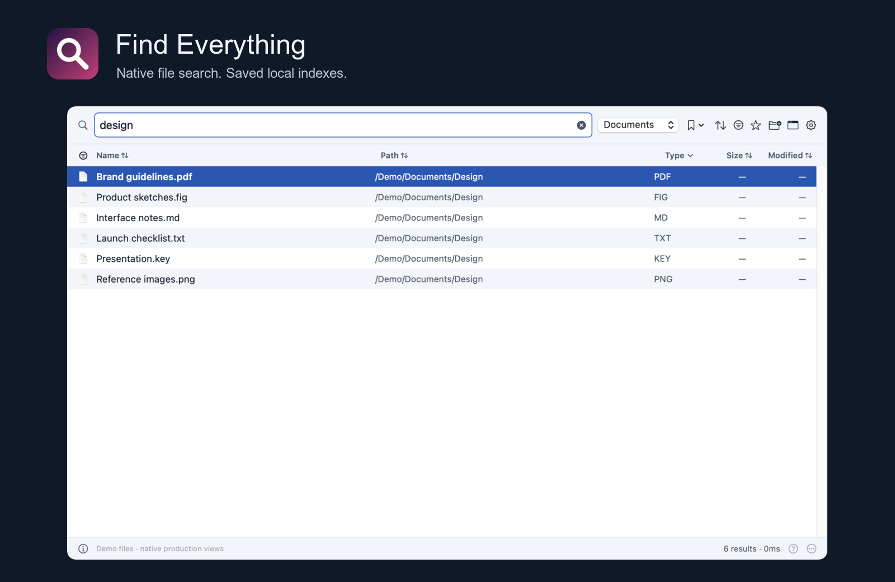

# Find Everything 0.14.0 · Apple Silicon preview

Native macOS file search with saved local indexes, a CLI and optional Raycast integration.



## Changes

- Fix startup selection when the remembered scope has no index; reuse an available saved snapshot instead of silently starting a scan.
- Fix All (`/`) index creation stopping at 1 GiB of streamed path output. The new output budget is capped at 8 GiB and further limited by initial free disk space minus 256 MiB. Existing backpressure, timeout, path guards and atomic replacement remain.
- Require the pinned publisher and Gatekeeper approval in the remote installer. Do not implicitly enable live/nightly indexing during an update.
- Replace unchecked in-app helper downloads with trusted package-manager instructions and a tool recheck.
- Preserve saved typing-delay preferences; clarify missing-index and searching states; improve labels and shared control contrast.
- Include project/Bun notices, release manifest, SHA-256 checksums and privacy-clean product images.

## Download and verification

`FindEverything.app.zip` contains the Apple Silicon app, compiled CLI and native helpers. The complete bundle requires macOS 15 or later; it was built and checked on macOS 15.8.2. Download `SHA256SUMS.txt` and `release.json` beside it, then run:

```sh
shasum -a 256 -c SHA256SUMS.txt
```

Checksums detect changed files. They are not trusted publisher identity or notarization evidence.

## Important preview limits

**This build is locally signed and not notarized.** It is not a normal Developer ID-distributed macOS release. Gatekeeper may refuse it; the remote installer intentionally refuses unapproved previews. Do not remove quarantine, disable Gatekeeper or reset privacy permissions to get around this. Build from source with your own identity or wait for a notarized release.

Only the available Apple Silicon environment was exercised. Intel, older macOS, manual complete keyboard/VoiceOver flows, prolonged memory/recovery behaviour and full third-party legal review remain unverified. Native images are offscreen renders of production views with synthetic files, not private screenshots or performance measurements. A real >1-GiB whole-disk indexing scan was not run; the regression exercises byte accounting and bounds without allocating or scanning a gigabyte.

Optional semantic models, runtime dependencies and fd/ripgrep/fzf are not redistributed in the app archive. Review [third-party notices](https://github.com/Supersynergy/find-everything/blob/v0.14.0/THIRD-PARTY-NOTICES.md) and the [release register](https://github.com/Supersynergy/find-everything/blob/v0.14.0/COMPLIANCE.md). No security, legal or accessibility certification is claimed.
